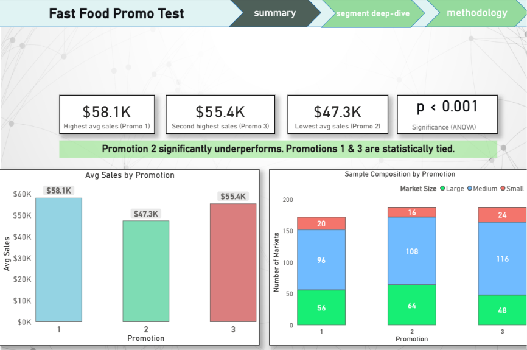
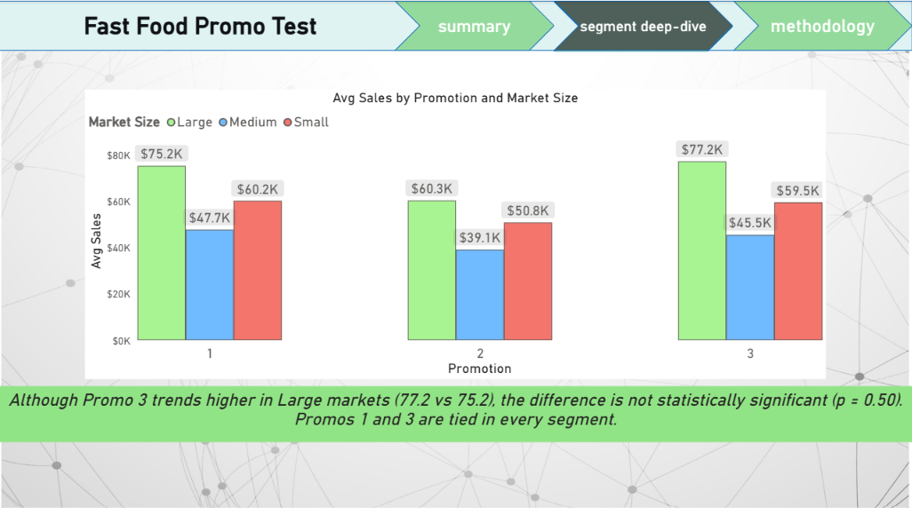

# Which Promotion Should We Launch?

**An A/B test analysis of 3 marketing campaigns across 137 fast-food stores**

---

## TL;DR

A fast-food chain tested 3 promotions for a new menu item across 137 stores over 4 weeks.

**Result:**
- **Promotions 1 and 3 are statistically tied** at the top ($58.1K and $55.4K avg weekly sales)
- **Promotion 2 significantly underperforms** in every market segment ($47.3K)
- **Recommendation: Launch Promotion 1** (or Promotion 3). **Do not launch Promotion 2.**

---

## Business Question

The chain is launching a new menu item and has three candidate promotions. Which promotion drives the highest sales, and should we roll it out chain-wide?

To answer this, the chain ran the three promotions in randomly selected markets over four weeks and recorded weekly sales per store.

---

## Data

| Field | Description |
|---|---|
| **Source** | [Kaggle - Fast Food Marketing Campaign A/B Test](https://www.kaggle.com/datasets/chebotinaa/fast-food-marketing-campaign-ab-test) |
| **Original** | IBM Watson Analytics Marketing Campaign |
| **Rows** | 548 (137 stores x 4 weeks) |
| **Stores** | 137 across 10 markets |
| **Promotions** | 3 (assigned at the store level) |
| **Market sizes** | Small, Medium, Large |

---

## Method

### Design
This is a **between-groups** experiment - each store was assigned exactly one promotion for the entire 4-week period. It is **not** a within-store randomized test, which limits causal claims (see *Caveats* below).

### Balance Check
| Metric | Promo 1 | Promo 2 | Promo 3 |
|---|---|---|---|
| # Stores | 43 | 47 | 47 |
| Avg Store Age | 8.3 yrs | 8.0 yrs | 9.2 yrs |
| % Large Market | 33% | 34% | 26% |

- **Age of store:** well-balanced across groups
- **Market size:** mildly imbalanced - Promotion 3 had fewer Large-market stores, so we ran segment-level analyses to control for this

### Statistical Tests
1. **Overall ANOVA** - tests if the three promotions differ on average
2. **Pairwise t-tests** with Bonferroni correction - identifies which specific promotions differ
3. **Segment-level ANOVAs** - repeats the analysis within Large, Medium, and Small markets to detect segment-specific effects

---

## Key Findings

### Overall Sales by Promotion

| Promotion | Avg Weekly Sales | vs Promo 1 (p) |
|---|---|---|
| **1** | **$58.1K** | - |
| 2 | $47.3K | < 0.001 (significant) |
| **3** | **$55.4K** | 0.12 (tied) |

**Overall ANOVA:** F(2, 545) = 21.95, **p < 0.001** - promotions differ significantly.

**Pairwise (Bonferroni alpha = 0.0167):**
- Promo 1 vs Promo 2 - significant
- Promo 1 vs Promo 3 - **not significant** (tied)
- Promo 2 vs Promo 3 - significant

### Segment Deep-Dive

| Segment | Promo 1 | Promo 2 | Promo 3 | Winner |
|---|---|---|---|---|
| **Large** | $75.2K | $60.3K | **$77.2K** | Promo 3 (trend) |
| **Medium** | **$47.7K** | $39.1K | $45.5K | Promo 1 |
| **Small** | **$60.2K** | $50.8K | $59.5K | Promo 1 |

**All three segment ANOVAs significant (p < 0.001).**

**But pairwise tests within each segment show the same pattern everywhere:**
- Promo 1 > Promo 2 (significant)
- Promo 3 > Promo 2 (significant)
- **Promo 1 vs Promo 3 - NOT significant in any segment**

So although Promotion 3 *trends* higher in Large markets, the difference from Promotion 1 is not statistically supported.

---

## Recommendation

> **Roll out Promotion 1** (or Promotion 3 - they are statistically tied). **Drop Promotion 2.**

**Why:**
- Promotion 2 underperforms in every segment by roughly $8K-$17K per store per week
- Promotions 1 and 3 are statistically indistinguishable on every metric
- Promotion 1 wins the raw overall average, making it the slightly safer pick

**Expected impact:**
Replacing Promotion 2 with Promotion 1 across the chain's stores would lift average weekly sales from $47.3K to $58.1K - a **+23% relative lift**.

---

## Caveats

1. **Between-groups design, not true A/B.** Promotions were assigned at the market level, so store-level factors (location, foot traffic, local competition) could confound results. A within-store randomized test would be needed to make definitive causal claims.

2. **Market size imbalance.** Promotion 3 had fewer Large-market stores (26% vs 33% for Promotion 1). This was addressed by analyzing each segment separately.

3. **Multiple comparisons.** Bonferroni correction was applied to control the family-wise error rate across pairwise tests.

---

## Repository Contents

| File | Contents |
|---|---|
| `data/WA_Marketing-Campaign.csv` | Raw dataset (548 rows) |
| `analysis/fast-food-promo-analysis.xlsx` | Full Excel workbook - raw data, EDA pivots, ANOVA, pairwise t-tests (7 tabs) |
| `analysis/fast-food-promo-analysis.pdf` | PDF export for easy viewing |
| `dashboard/promo_analysis.pbix` | Power BI dashboard (3 pages) |
| `screenshots/` | Dashboard and analysis screenshots |

**Note:** GitHub cannot preview `.xlsx` or `.pbix` files. Download them, or view the PDF and screenshots for a quick overview.

---

## Tools Used

- **Excel** - data validation, EDA, ANOVA, pairwise t-tests (Analysis ToolPak)
- **Power BI** - stakeholder-facing dashboard with KPI cards, callout banners, and segment deep-dive
- **Statistics** - one-way ANOVA, two-sample t-tests, Bonferroni correction

---

## License

Analysis is provided for educational and portfolio purposes. Dataset credit: [Anastasia Chebotina on Kaggle](https://www.kaggle.com/datasets/chebotinaa/fast-food-marketing-campaign-ab-test).
